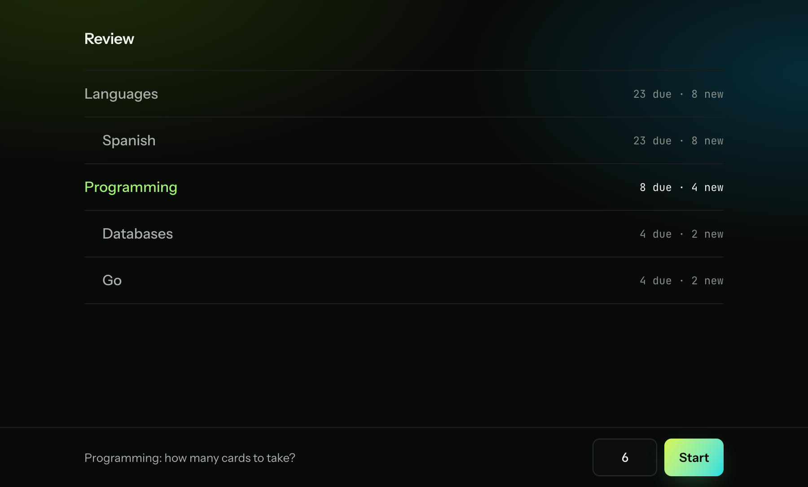
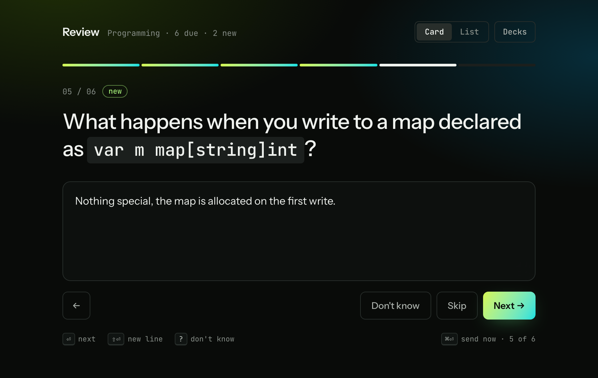
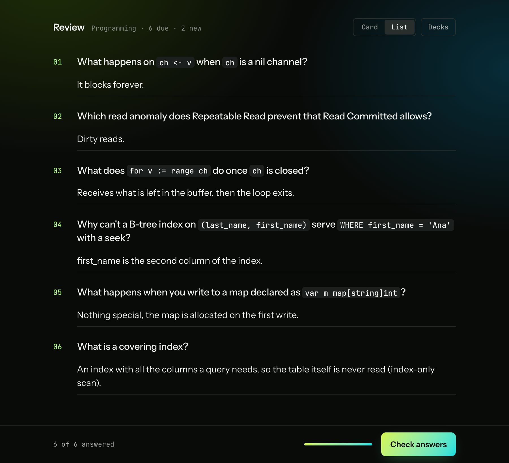
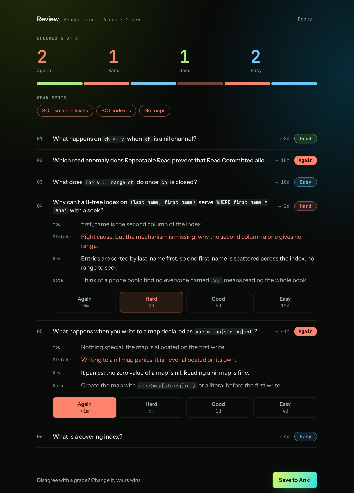

# anki-review

Review your due Anki cards on a web page: type the answers, Claude Code grades them against each
card's answer key, you confirm or change every grade, and the grades go back into Anki through its own
scheduler, the same as pressing the buttons in the reviewer.

The page and the grading feedback are in English.

## Screenshots

The decks, cards, answers and grades in these shots are a made-up demo.

The deck list with today's due and new cards; a parent deck takes its subdecks along.



One card at a time. Code in backticks on a card renders as code, new cards are marked.



The same batch as a list, all answers on one screen.



The grades: counts, weak spots, and per card your answer, the mistake, the answer key and a note.
Each grade button shows the interval Anki will set; change any grade before **Save to Anki**.



## How it works

The first time, the page asks you to set up an owner login and enter the two tokens:
[First start: the setup page](#first-start-the-setup-page). After that you log in on the page.

1. Pick a deck and how many cards to take. Cards come in Anki's order: learning, reviews, then new
   cards within the deck's daily limit.
2. Type the answers, one card at a time or as a list. `?` means "I don't remember", an empty answer
   skips the card (it stays due).
3. **Check answers** sends the answers. The server grades the whole batch with one `claude -p` call.
   The answer keys reach the page only now, together with the grades.
4. Change any grade you disagree with and press **Save to Anki**. The server answers the cards through
   AnkiConnect and syncs with AnkiWeb. A card reviewed elsewhere in the meantime is skipped, not
   answered twice.
5. Take more cards from the same deck (**More cards**) or go back to the deck list (**Decks**).

Decks listed in `KNOWLEDGE_DECKS` (top-level names) are graded by meaning. All other decks are graded
as language cards: the exact word, its form, collocation and spelling count.

## Requirements

- [Go](https://go.dev/dl/) 1.27 or newer, to build.
- [Anki](https://apps.ankiweb.net/) desktop with the [AnkiConnect](https://ankiweb.net/shared/info/2055492159)
  add-on (code `2055492159`). Anki must be running while you review.
- [Claude Code](https://docs.claude.com/en/docs/claude-code/overview), logged in: `claude -p "hi"`
  answers in a terminal. Grading uses your Claude subscription or API key.

## Run locally

```sh
git clone https://github.com/scv3lqq/anki-review.git
cd anki-review
make run
```

Open <http://127.0.0.1:8767/> and set up the owner login and the tokens:
[First start](#first-start-the-setup-page). Later, log in, pick a deck and press **Start**.

To get a binary instead: `make build`, then run `bin/anki-review`. The page is embedded, the binary
needs no other files.

With Claude Code: open the clone in Claude Code and run `/setup-anki-review`, or just ask it to set
the app up. It checks the requirements, builds, asks which decks are knowledge decks and starts the
server. `/setup-anki-review check` only reports what is missing. You type the login, the password and
both tokens into the setup page yourself; the skill explains where each token comes from and never
sees them.

## First start: the setup page

The first time, the page shows **Set up** instead of the decks:

| Field | What to enter |
| --- | --- |
| Login, Password, Repeat password | The owner login (up to 64 characters) and a password of at least 12 characters. The password unlocks the server after each restart and encrypts both tokens. |
| Claude token | See below |
| AnkiConnect key | See below |

**Claude token.** On a computer with Claude Code, where `claude` is logged in to your Claude account
(Pro, Max, Team or Enterprise), run `claude setup-token` in a terminal. It opens the browser: approve
the access. The terminal then prints a token that starts with `sk-ant-oat01-`. It is valid for one year
and grading uses your subscription. Paste it. An Anthropic API key (`sk-ant-api03-...`) works too,
billed per use. Leave it empty only when the server runs on your own computer and `claude` already
works there for the account that runs the server.

**AnkiConnect key.** In Anki on your computer, open Tools > Add-ons, select AnkiConnect, press Config
and copy the value of `apiKey`. If it is `null`, leave the field empty. On a server set up with the
[deploy kit](deploy/README.md), the key was generated during the deploy.

Setup checks the AnkiConnect key first (Anki must be running), then makes one tiny Claude call (a
little of your quota). Only then it seals both tokens in `DATA_DIR/vault.json` and logs you in. After a
restart the page shows **Log in**: until you log in, the server is locked and grading waits. Once
logged in, **Settings** changes the password or either token; an empty field keeps its current value.

## Run on a server

[deploy/README.md](deploy/README.md) runs it on a Linux server: Anki headless in Docker, the app as a
hardened systemd service behind your own reverse proxy. With Claude Code, `/setup-anki-review server`
does the whole deploy over ssh; you type the AnkiWeb password in the VNC window, the sudo password and
the setup form on the page. `/setup-anki-review server-update` ships a new build.

## Use

| Key | Action |
| --- | --- |
| <kbd>Enter</kbd> | next card |
| <kbd>Shift</kbd>+<kbd>Enter</kbd> | line break in an answer |
| <kbd>?</kbd> in an empty answer | "I don't remember" (graded Again) |
| <kbd>Cmd</kbd>/<kbd>Ctrl</kbd>+<kbd>Enter</kbd> | send all answers now |

- Typed answers are kept in the browser, so a reload loses nothing.
- If grading fails (Claude usage limit, timeout), the page says why and offers **Check again**.
- If Anki refuses the answers because a deck's study screen is open, go back to Anki's deck list and
  press **Save to Anki** again.
- A pass left unfinished for 12 hours is dropped on the next visit.
- The server keeps the current pass in `DATA_DIR`: a restart resumes it, grading or writing included.

## Configuration

Environment variables, all optional. To keep them in a file, `cp .env.example .env` and edit it:
`make run` reads `.env` (the binary itself reads only its environment).

| Variable | Default | Meaning |
| --- | --- | --- |
| `PORT` | `8767` | Port on 127.0.0.1 |
| `DATA_DIR` | `./data` | State of the current pass (it holds the answer keys) and `vault.json` (the sealed tokens). The directory is `0700`, the files `0600` |
| `KNOWLEDGE_DECKS` | `Tech,Career` | Top-level decks graded by meaning, comma-separated |
| `ANKI_CONNECT_URL` | `http://127.0.0.1:8765` | AnkiConnect endpoint |
| `ANKI_SYNC` | `true` | Sync with AnkiWeb before a pass and after writing grades |
| `CLAUDE_BIN` | `claude` | Claude Code binary |
| `CLAUDE_MODEL` | the CLI's default | Model for grading, for example `sonnet` |
| `GRADE_TIMEOUT` | `5m` | Longest time one grading call may take |
| `LOG_LEVEL` | `info` | `debug`, `info`, `warn`, `error` |

The Claude token and the AnkiConnect key are not settings: enter them on the setup page. If
`ANKI_CONNECT_KEY` or `CLAUDE_CODE_OAUTH_TOKEN` is set in the environment, the server ignores it, logs a
warning and removes it from its own environment.

Logs go to stderr: readable in a terminal, JSON lines otherwise. They never contain card text, answers,
passwords or tokens.

## Security

The server listens on 127.0.0.1 only. The page files (HTML, CSS, JS) are public; every API route except
the session, setup and login ones needs the owner's login.

- **Owner login.** One owner, created on the setup page. Wrong passwords and failed setup checks are
  counted per client: the first 5 cost nothing, after that each try waits twice as long as the last, up
  to 15 minutes. The client is the last `X-Forwarded-For` hop (the one your proxy adds), else
  `X-Real-IP`, else the connection's address. Settings keep their own count, so strangers failing to
  log in can't lock a logged-in owner out of them.
- **Sessions.** A random cookie: `HttpOnly`, `SameSite=Strict`, 30 days, kept in memory only, so a
  restart logs everyone out. The cookie is `Secure` when the proxy sends `X-Forwarded-Proto: https`.
  Changing the password logs out the other sessions.
- **Sealed tokens.** The Claude token and the AnkiConnect key live in `DATA_DIR/vault.json`, encrypted
  with XChaCha20-Poly1305 under a key from Argon2id (3 passes, 64 MiB) of the owner's password. Every
  save uses a fresh salt and nonce, and the file is replaced atomically.
- **Locked after a restart.** The tokens are in plaintext only in the server's memory, and only after a
  login. Until then nothing that needs Anki or Claude runs.
- **What it protects.** The tokens stay unreadable on a copy of the disk, in a backup or snapshot, in
  an env file, and for other users of the machine. A stolen `vault.json` costs one Argon2id run per
  password guess.
- **What it does not protect.** Root, or the service user, on the machine that runs the server can read
  the server's memory while it is unlocked, and so the tokens. On a deploy-kit server the AnkiConnect
  key also sits in `anki/secrets/` for the Anki container, so the vault mainly guards the Claude token.
- **Forgotten password.** There is no recovery. Stop the server, delete `DATA_DIR/vault.json`, start it
  and set up again with both tokens. On a server: `sudo rm /var/lib/anki-review/data/vault.json`, then
  `systemctl restart anki-review` (the restart drops the tokens still in memory).
- Requests with any `Host` other than `127.0.0.1` or `localhost` are refused, so a foreign site can't
  reach it through DNS rebinding. A reverse proxy in front must send `Host: 127.0.0.1:<port>`, and
  should send `X-Forwarded-Proto` and `X-Forwarded-For`: without them the cookie isn't `Secure` and all
  clients share one throttle count.
- POST requests must be JSON, so other sites can't submit forms to it. The page runs under a strict
  Content Security Policy.
- Claude runs as `claude -p --safe-mode --tools ""`: no tools, MCP servers, hooks or CLAUDE.md, so text
  on a card can't make it act. The prompt goes through stdin, not the command line.
- Card text and your answers are sent to Anthropic through Claude Code.

To report a vulnerability, see [SECURITY.md](SECURITY.md).

## Development

```sh
make check   # golangci-lint v2 and go test -race
```

| Path | What |
| --- | --- |
| `cmd/anki-review` | entry point: config from the environment, logger, signals |
| `internal/domain` | the pass, its stages and the rules that need neither Anki nor Claude |
| `internal/usecase/review` | the review flow; ports for Anki, the grader and the state store |
| `internal/usecase/owner` | setup, login, sessions, settings, throttling and the lock |
| `internal/repository/vault` | `vault.json`: the tokens sealed under the owner's password |
| `internal/repository/ankiconnect` | AnkiConnect client, card rendering, the due queue |
| `internal/repository/claude` | grading prompts and the `claude -p` call |
| `internal/repository/filestore` | the state file |
| `internal/handler/httpapi` | JSON API, static page, host guard |
| `internal/app` | wiring and the HTTP server |
| `web` | the page: plain HTML, CSS and JS, embedded into the binary |
| `assets/screenshots` | README screenshots of a made-up demo |
| `deploy` | the server deploy kit, see its README |
| `.claude/skills/setup-anki-review` | the Claude Code setup skill and its helper scripts |

Tests fake Anki with an in-memory AnkiConnect server and Claude with the test binary itself
(`internal/testutil`), so `make check` needs neither.

[pre-commit](https://pre-commit.com/) runs gitleaks before each commit: `pre-commit install` once.

## License

[MIT](LICENSE)
